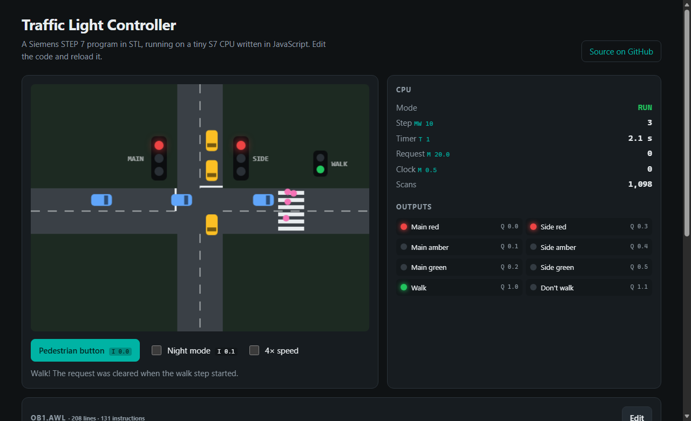

# Traffic Light Controller


A junction with a pedestrian crossing, programmed for a Siemens S7-300/400 PLC in **STEP 7 STL** (Statement List). It runs in the browser on a small S7 CPU emulator written in JavaScript, so you can watch the real program drive the lights, and edit it.

**[Try it in the browser](https://jhleez1.github.io/traffic-light-controller/)**



## The program

`step7/OB1.awl` is an STL source file. Import it in SIMATIC Manager (*Sources → Insert New Object → External Source*, then *Compile*) and test it in S7-PLCSIM.

| Step | Main road | Side road | Pedestrians | Time |
| --- | --- | --- | --- | --- |
| 0 | green | red | wait | 6 s |
| 1 | amber | red | wait | 2 s |
| 2 | red | red | wait | 1 s |
| 3 | red | red | **walk** (only if requested) | 4 s |
| 4 | red | green | wait | 4 s |
| 5 | red | amber | wait | 2 s |
| 6 | red | red | wait | 1 s |

- **Pedestrian button (I 0.0)** is latched into `M 20.0`, so a quick press is never missed. The walk step is skipped if nobody pressed it, and the request is cleared when the walk step starts.
- **Night mode (I 0.1)** flashes both ambers using the CPU's 1 Hz clock memory bit `M 0.5` and holds the sequence at step 0.
- **One timer for every step:** a jump list (`JL`) loads the right `S5T#` time for the current step into `T 1`. A one-scan flag (`M 30.0`) restarts the timer after each step change.
- **Out-of-range step numbers** recover to step 0 instead of leaving the lights dark.

`st/TrafficLight.st` is the same controller as a Structured Text function block. Compare the two: STL needs a jump list and a restart flag, while ST does it with one `CASE`.

## The S7 emulator

`stl.js` parses the STL source and runs it scan by scan. It supports:

- **Bit logic:** `A AN O ON`, with `A(` … `)` and a standalone `O` (AND before OR), `NOT SET CLR`, `= S R`
- **Words and maths:** `L T +I -I ==I <>I >I <I >=I <=I`
- **Timers:** `SD` on-delay timers, `R T`, `A T`
- **Jumps:** `JU JC JCN JL`, labels, `NOP BE BEU`
- **Memory:** I/Q/M areas, `MW` words, and the clock memory byte `MB 0`

Anything else is reported as an error with its line number.

The page highlights the lines that ran in the last scan, so you can *see* the jumps: lines that were skipped fade out.

## Files

| Path | What it is |
| --- | --- |
| `step7/OB1.awl` | The PLC program |
| `st/TrafficLight.st` | The same logic in Structured Text |
| `stl.js` | STL parser and S7 CPU emulator |
| `app.js` | Junction drawing, cars, pedestrians and the CPU panel |
| `test/ob1.test.js` | Runs the real `OB1.awl` and checks the sequence, timings, pedestrian request and night mode |
| `tools/embed.js` | Copies `OB1.awl` into `step7/ob1.js`, so the page works when opened from disk |

## Run it

Open `index.html` in a browser. Tests need Node 18 or newer:

```
node --test
```

If you change `OB1.awl`, run `node tools/embed.js` so the web page uses the new version. A test fails if you forget.

---

Built by [Jihan Lee](https://github.com/jhleez1), with help from Claude (AI) for the emulator and web page.
